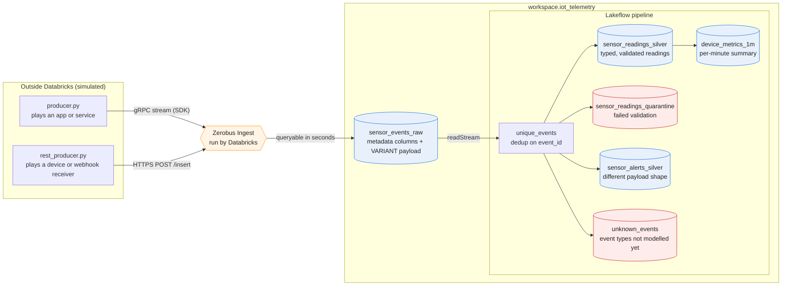

# Zerobus Ingest, end to end

Stream events from outside Databricks into a Unity Catalog table with
Zerobus Ingest, then clean them up with a Lakeflow pipeline. Infrastructure is
Terraform and a Databricks Asset Bundle, and the code is Python.

The [blog post](https://mloh.hashnode.dev/databricks-zerobus-ingest-vs-kafka-event-hubs) covers when Zerobus is worth using, what it costs,
and when Kafka or Event Hubs is still the better choice.

## Contents

- [Overview](#overview)
- [Prerequisites](#prerequisites)
- [Configuration](#configuration)
- [Setup](#setup)
- [Usage](#usage)
- [Cleanup](#cleanup)
- [Further reading](#further-reading)

## Overview



<sub>Orange is the managed service, blue is a table you can query, red is where rejected rows go.</sub>

Two producers stand in for systems you don't run. `producer.py` plays a
service streaming over gRPC with the Zerobus SDK, and `rest_producer.py` plays
a device or webhook receiver posting over HTTPS. They send made-up readings
and alerts from 50 sensors, with a few impossible temperatures for the
pipeline to reject.

The landing table has typed metadata columns that every event shares, plus a
`payload VARIANT` column for the event body. The pipeline dedupes on
`event_id`, pulls typed columns out of the payload, and sends failed readings
to quarantine.

## Prerequisites

- A Databricks workspace with Unity Catalog, serverless compute and a SQL
  warehouse, in a [region that supports Zerobus](https://docs.databricks.com/aws/en/ingestion/lakeflow-connect/zerobus-limits).
  [Databricks Free Edition](https://docs.databricks.com/aws/en/getting-started/free-edition)
  has all of these, and it's what this demo was built and tested on
- [Databricks CLI](https://docs.databricks.com/aws/en/dev-tools/cli/install),
  logged in with `databricks auth login`
- [Terraform](https://developer.hashicorp.com/terraform/install) 1.6 or later
- [uv](https://docs.astral.sh/uv/)

## Configuration

Set these before you start. The setup steps export the service principal's
credentials for you.

```bash
export DATABRICKS_CONFIG_PROFILE=<your-profile>
export DATABRICKS_HOST=https://<workspace-host>
# <workspace-id> is the number after ?o= in your workspace URL
export ZEROBUS_ENDPOINT=https://<workspace-id>.zerobus.<region>.cloud.databricks.com
export ZEROBUS_TABLE=workspace.iot_telemetry.sensor_events_raw

# Optional: only if you have no SQL warehouse called "Serverless Starter Warehouse"
export BUNDLE_VAR_warehouse_id=<warehouse-id>
```

## Setup

1. Create the service principal:

   ```bash
   cd terraform
   terraform init
   terraform apply -var databricks_profile=$DATABRICKS_CONFIG_PROFILE
   export ZEROBUS_CLIENT_ID=$(terraform output -raw sp_application_id)
   export ZEROBUS_CLIENT_SECRET=$(terraform output -raw sp_client_secret)
   cd ..
   ```

2. Deploy the bundle:

   ```bash
   export BUNDLE_VAR_sp_application_id=$ZEROBUS_CLIENT_ID
   databricks bundle deploy
   ```

   This deploys to `workspace.iot_telemetry`. Add `-t dev` to this and every
   later `bundle` command to get your own copy, named
   `dev_<your-username>_iot_telemetry`.

3. Create the landing table. Zerobus only writes to a table that already
   exists.

   ```bash
   databricks bundle run setup
   ```

## Usage

Send events, from the repo root:

```bash
uv sync
uv run zerobus-produce --records 10000
uv run zerobus-produce-rest --records 200
```

Add `--rate 1000` to spread the gRPC events out, and watch them arrive:

```sql
SELECT ingest_source, event_type, count(*), max(event_ts)
FROM workspace.iot_telemetry.sensor_events_raw
GROUP BY ALL;
```

Then run the pipeline and check where every event went:

```bash
databricks bundle run process
```

With the commands above, 10,200 events go in and come out as 9,510 clean
readings, 202 quarantined readings and 488 alerts. Run `process` again after
each send. The pipeline only picks up new rows.

To write your own producer, send the `VARIANT` payload as a JSON string and
timestamps as microseconds since 1970. `to_wire()` in
[events.py](src/zerobus_demo/events.py) shows both.

## Cleanup

Destroy the bundle first, because its schema grants point at the service
principal. This drops the schema and every table in it, along with the
pipeline and both jobs. `BUNDLE_VAR_sp_application_id` must be set.

```bash
databricks bundle destroy
cd terraform
terraform destroy -var databricks_profile=$DATABRICKS_CONFIG_PROFILE
cd ..
```

If you deployed with `-t dev`, also run `databricks bundle destroy -t dev`.

## Further reading

- [Zerobus Ingest documentation](https://docs.databricks.com/aws/en/ingestion/lakeflow-connect/zerobus-ingest)
- [Limits and quotas](https://docs.databricks.com/aws/en/ingestion/lakeflow-connect/zerobus-limits)
- [Python SDK](https://pypi.org/project/databricks-zerobus-ingest-sdk/)
